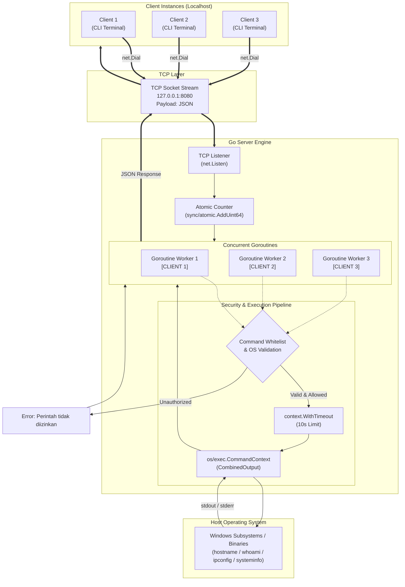
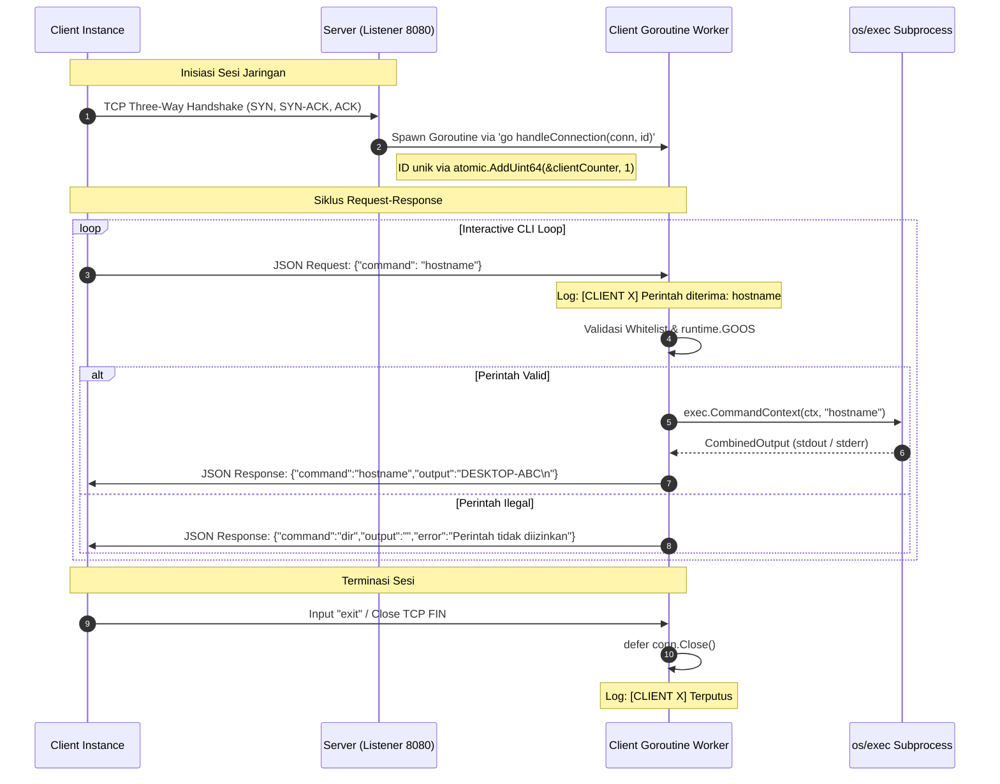

# Go Concurrent TCP Remote Execution Engine


Implementasi sistem *client-server* berbasis *Transmission Control Protocol* (TCP) menggunakan bahasa pemrograman Go dengan arsitektur multi-koneksi konkuren (*goroutine-driven*) untuk mengeksekusi perintah diagnostik sistem operasi secara jarak jauh (*remote execution*). Sistem dirancang khusus untuk eksekusi *native* pada lingkungan Windows dengan proteksi *command whitelisting*, pembatasan batas waktu eksekusi (*timeout*), serta pertukaran data terstruktur berformat JSON.

---

## 📐 Arsitektur Sistem

Sistem menggunakan model konkurensi M:N berbasis *Goroutine*. *Main thread server* bertindak sebagai *listener* pasif yang mendelegasikan setiap sesi koneksi masuk ke *worker goroutine* terpisah, sehingga mampu melayani banyak *client* secara simultan tanpa *blocking*.



---

## 🔄 Alur Komunikasi & Protokol (Sequence Diagram)

Pertukaran data memanfaatkan abstraksi *streaming* `json.Encoder` dan `json.Decoder` langsung di atas aliran *socket* TCP (`net.Conn`):



---

## ✨ Fitur Utama

* **Concurrent Multi-Client Handling:** Menggunakan *goroutine* ringan untuk melayani koneksi banyak *client* secara paralel tanpa membebani sumber daya sistem operasi.
* **Thread-Safe Client Identification:** Menggunakan `sync/atomic.AddUint64` untuk menjamin keunikan penomoran ID *client* (`CLIENT 1`, `CLIENT 2`, dst.) bebas dari kondisi *race condition*.
* **Command Whitelisting:** Perlindungan terhadap ancaman *remote arbitrary command execution* dengan membatasi eksekusi hanya pada perintah yang terdaftar.
* **Execution Timeout Safeguard:** Pembatasan waktu proses sub-sistem selama maksimal 10 detik via `context.WithTimeout` guna mencegah proses macet (*hang*).
* **OS-Specific Guardrail:** Pengecekan otomatis variabel `runtime.GOOS` untuk memastikan utilitas diagnostik Windows (`ipconfig` dan `systeminfo`) hanya dieksekusi pada lingkungan yang sesuai.
* **Standardized JSON Framing:** Menggunakan objek `Request` dan `Response` terstruktur dengan tag `omitempty` untuk meminimalkan ukuran transmisi data.

---

## 📂 Struktur Direktori Proyek

```text
go-remote-execution/
├── client/
│   └── main.go       # Program client CLI, handler socket, dan parser JSON
├── server/
│   └── main.go       # Listener TCP, manajemen goroutine, dan executor perintah
└── go.mod            # File konfigurasi modul Go (module remote-execution)
```

---

## 📋 Daftar Perintah yang Diizinkan

| Perintah | Target Eksekusi | Batasan Platform | Deskripsi Fungsional |
| :--- | :--- | :--- | :--- |
| `hostname` | `hostname.exe` | Lintas Platform | Mengambil dan menampilkan nama *host* komputer *server*. |
| `whoami` | `whoami.exe` | Lintas Platform | Menampilkan identitas akun pengguna (*username*) Windows aktif pada *server*. |
| `ipconfig` | `ipconfig.exe` | `windows` only | Menampilkan konfigurasi antarmuka jaringan dan alamat IPv4/IPv6 *server*. |
| `systeminfo` | `systeminfo.exe` | `windows` only | Menampilkan rincian konfigurasi sistem operasi dan spesifikasi perangkat. |
| `exit` | *Internal CLI* | Lintas Platform | Memutuskan sesi koneksi TCP dan menutup program *client*. |

> **Catatan Keamanan:** Perintah di luar daftar di atas (misalnya `dir`, `rmdir`, `powershell`, atau upaya penyisipan operator chaining `&&`, `|`) akan otomatis ditolak dengan pesan galat `"Perintah tidak diizinkan"`.

---

## 🚀 Panduan Instalasi & Penggunaan

### Prasyarat Lingkungan
* Sistem Operasi: Windows 10 / 11 (64-bit)
* [Go Compiler](https://go.dev/dl/) versi `1.27.3` atau lebih baru
* Terminal Windows PowerShell atau Command Prompt

### 1. Kloning Repositori
```powershell
git clone https://github.com/hidvicaesar/TCP_Host-Client.git
cd TCP_Host-Client/go-remote-execution
```

### 2. Menjalankan Server
Buka terminal PowerShell pertama dan jalankan perintah:
```powershell
go run ./server/main.go
```
*Output Terminal Server:*
```text
========================================
       GO REMOTE EXECUTION SERVER
========================================
Server berjalan di 127.0.0.1:8080
Menunggu koneksi client...
```

### 3. Menjalankan Client
Buka jendela terminal PowerShell kedua dan jalankan perintah:
```powershell
go run ./client/main.go
```
*Output Terminal Client:*
```text
================================
 GO REMOTE EXECUTION CLIENT
================================
Berhasil terhubung ke server!

Perintah tersedia:
- hostname
- whoami
- ipconfig
- systeminfo
- exit

Masukkan perintah: hostname

========== HASIL SERVER ==========
Perintah: hostname
Output:
DESKTOP-TELECOM

==================================
```

---

## 🧪 Pengujian Konkurensi (3 Client dalam 1 Host)

Pengujian dilakukan untuk membuktikan ketahanan *server* saat menerima koneksi simultan dari tiga *instance client* yang berjalan bersamaan di alamat *loopback* `127.0.0.1:8080`:

```text
┌─────────────────────────────────┐   ┌─────────────────────────────────┐
│       TERMINAL: CLIENT 1        │   │       TERMINAL: CLIENT 2        │
│ Masukkan perintah: whoami       │   │ Masukkan perintah: hostname     │
│ [Output: DESKTOP-PC\Engineer]   │   │ [Output: DESKTOP-PC]            │
└─────────────────────────────────┘   └─────────────────────────────────┘
                 ▲                                     ▲
                 │                                     │
                 └──────────────────┬──────────────────┘
                                    │
                                    ▼
┌───────────────────────────────────────────────────────────────────────┐
│                           TERMINAL: SERVER                            │
│ 2026/11/10 10:00:01 [CLIENT 1] Terhubung | IP: 127.0.0.1:52140        │
│ 2026/11/10 10:00:03 [CLIENT 2] Terhubung | IP: 127.0.0.1:52145        │
│ 2026/11/10 10:00:05 [CLIENT 3] Terhubung | IP: 127.0.0.1:52151        │
│ 2026/11/10 10:00:10 [CLIENT 1] Perintah diterima: whoami              │
│ 2026/11/10 10:00:10 [CLIENT 1] Hasil berhasil dikirim                 │
│ 2026/11/10 10:00:12 [CLIENT 2] Perintah diterima: hostname            │
│ 2026/11/10 10:00:12 [CLIENT 2] Hasil berhasil dikirim                 │
└───────────────────────────────────────────────────────────────────────┘
                                    ▲
                                    │
┌───────────────────────────────────┴───────────────────────────────────┐
│                          TERMINAL: CLIENT 3                           │
│ Masukkan perintah: ipconfig                                           │
│ [Output: Windows IP Configuration - Ethernet adapter & IPv4 details]  │
└───────────────────────────────────────────────────────────────────────┘
```

### Hasil Analisis Konkurensi
1. **Pemisahan Port Sumber:** Setiap *client* dialokasikan nomor *ephemeral port* independen oleh sistem operasi Windows (misal: `52140`, `52145`, `52151`), mencegah tubrukan paket data.
2. **Isolasi Eksekusi:** Perintah dengan waktu proses tinggi (`systeminfo` atau `ipconfig`) pada satu *client* tidak memicu kelambatan (*head-of-line blocking*) bagi *client* lain yang menjalankan perintah cepat (`hostname`).
3. **Atomic Counting:** Identifikasi terminal terurut secara deterministik (`CLIENT 1`, `CLIENT 2`, `CLIENT 3`) tanpa bentrok nilai variabel bersama.

---

## 📦 Spesifikasi Skema Data (JSON Payload)

### Request (Client -> Server)
```json
{
  "command": "whoami"
}
```

### Response (Server -> Client - Berhasil)
```json
{
  "command": "whoami",
  "output": "desktop-telecom\\student\r\n"
}
```

### Response (Server -> Client - Ditolak)
```json
{
  "command": "dir",
  "output": "",
  "error": "Perintah tidak diizinkan"
}
```

---

## 👤 Penulis

* **Nama:** Hidvicaesar Ayangfaana Hafidz
* **NIM:** 4.31.23.1.10
* **Kelas / No. Absen:** TE-4B / 09
* **Program Studi:** Sarjana Terapan Teknik Telekomunikasi, Politeknik Negeri Semarang